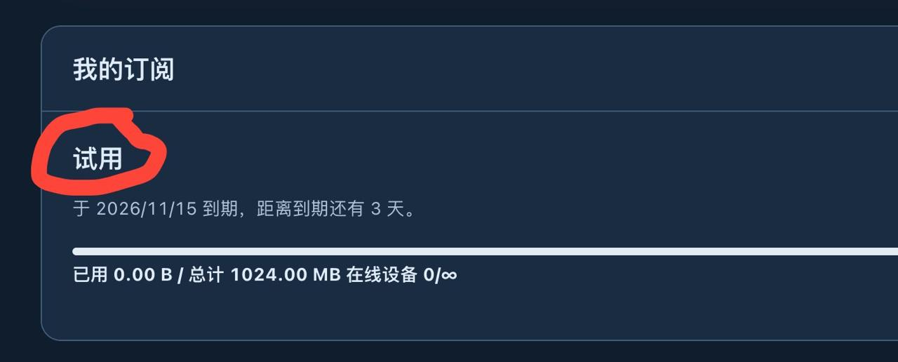
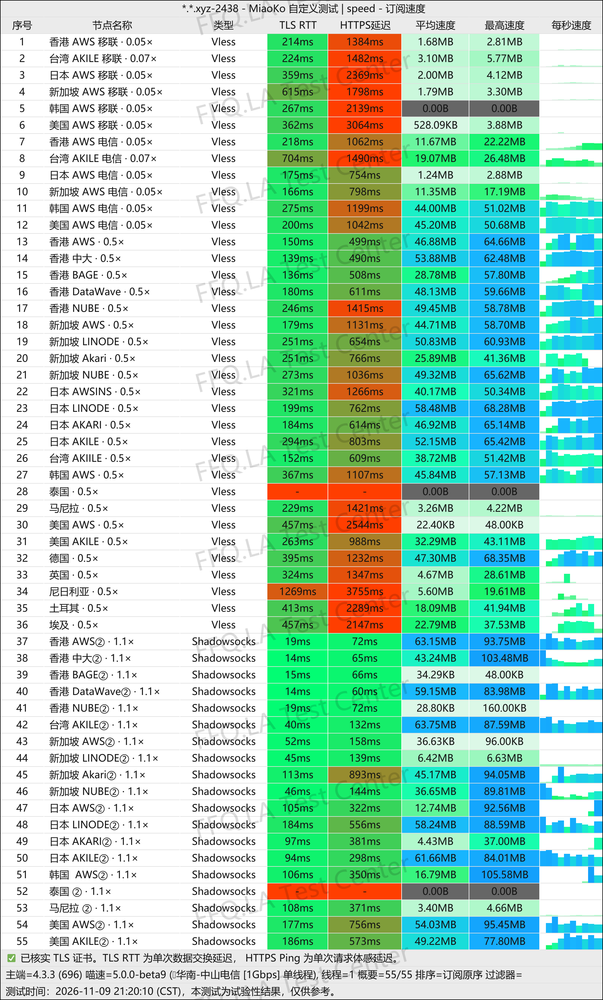
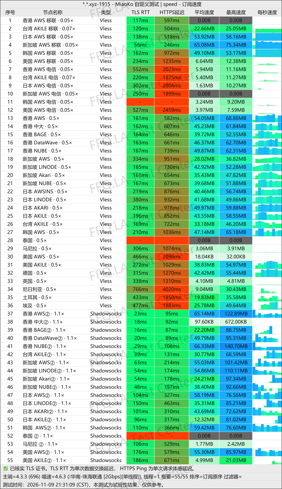
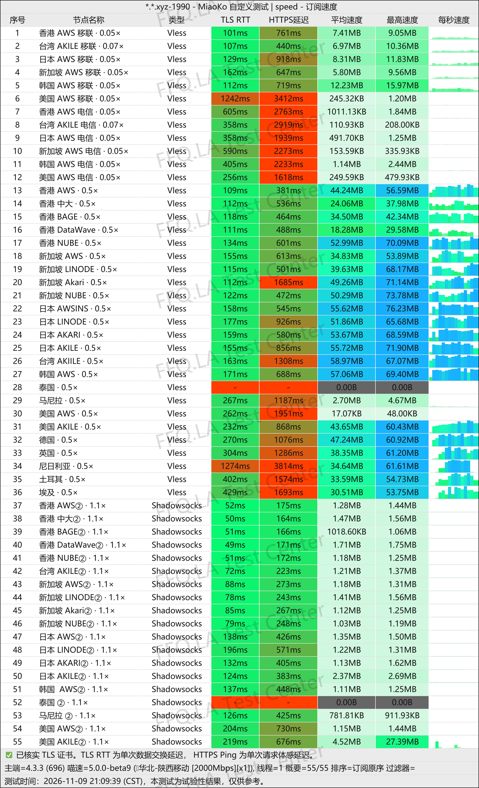
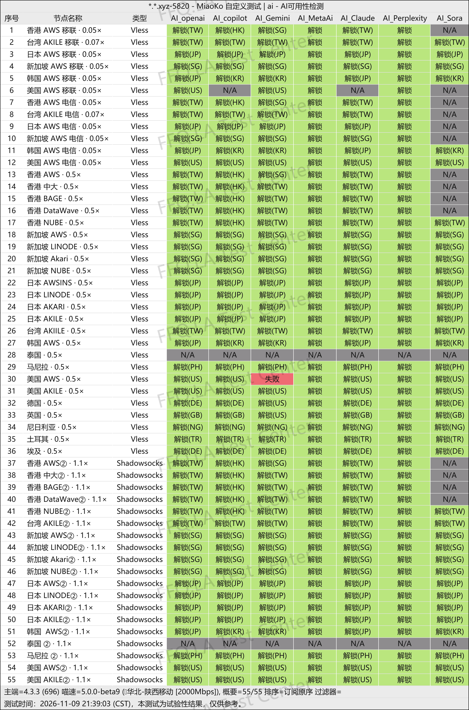
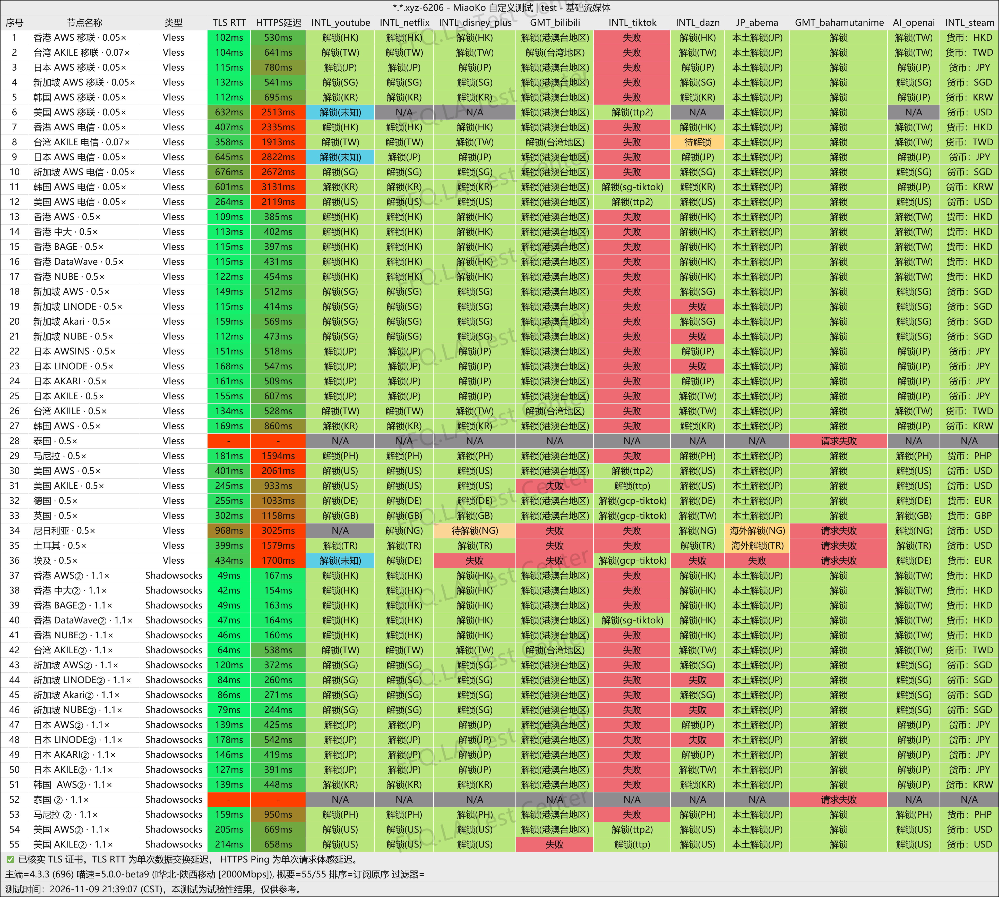
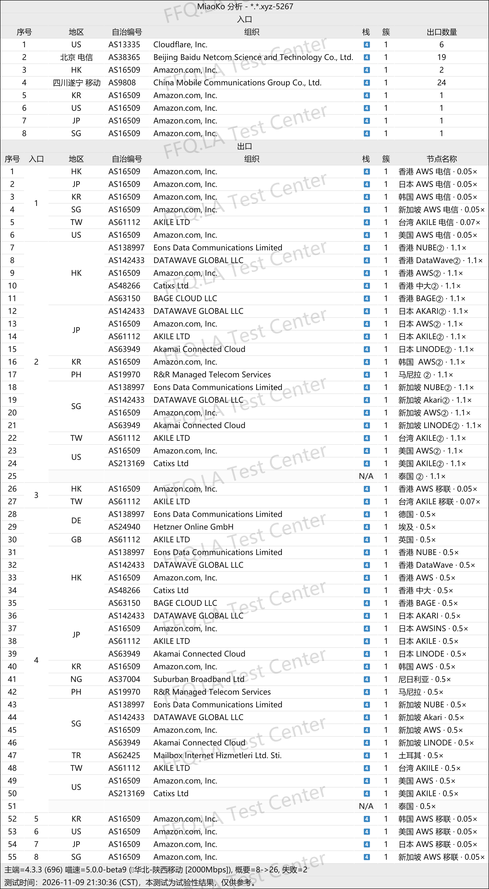

🇨🇳 中文 | 🇺🇸 [English](README_EN.md) | 🇷🇺 
[Русский](README_RU.md) | 🇮🇷 [فارسی](README_FA.md)

# NiuNiu牛牛机场官方地址(2026年11月14日更新)
NiuNiu牛牛机场官网地址</br>
最新地址：[www.niuniuxxx.cc](https://to.iix.im/nn01)</br>
官方地址：[www.niuniuxxx.cc](https://to.iix.im/nn01)</br>

2026最新好用的机场推荐与节点分享：[https://github.com/jdnei/JiChangTuiJian](https://github.com/jdnei/JiChangTuiJian)</br>
## Telegram VPN 机场福利社 #AD
[机场抽奖群](https://331024.de/archives/choujiang)｜[机场聊天群](https://331024.de/archives/choujiang)｜[机场体验群](https://331024.de/archives/choujiang)</br>

[https://331024.de/archives/choujiang](https://331024.de/archives/choujiang)
## 邀请码
`此邀请码注册，可得免费3天试用套餐(此活动官方随时取消)`
```bash
Wxy0327K
```
</br>
## 优惠码/折扣码
```bash

```
## 简介
NiuNiu牛牛机场是一家于2022年12月开业的网络加速服务商，主打国际中转与三网优化BGP线路，节点覆盖香港、台湾、日本、新加坡、美国及多个东南亚国家。提供月付、季付、年付及一次性流量套餐，支持流媒体和AI工具访问，适合日常上网、影音娱乐及多地区网络需求。
## 优势
牛牛机场的主要优势是套餐灵活、节点地区丰富，普通线路采用三网优化BGP中转，高级套餐提供更多优化节点。月付最低3.6元起，支持0.02至0.5倍低倍率计费，有效降低流量消耗。另有不限时流量包，标称最高2000Mbps带宽，兼顾轻度使用、影音娱乐和备用网络需求。
## 套餐

| 套餐        | 每月计费流量  | 价格          | 付款周期 | 节点倍率       | 理论可传输流量         | 峰值速率      | 高级线路  | 特色 / 备注           |
| --------- | ------- | ----------- | ---- | ---------- | --------------- | --------- | ----- | ----------------- |
| 国际中转10G-月 | 10 GiB  | ¥3.60 / 月   | 月付   | 0.05–0.06× | 约200 GiB        | 2000 Mbps | 不包含   | 每月自动重置流量；推荐腾讯云DNS |
| 国际中转20G-月 | 20 GiB  | ¥6.80 / 月   | 月付   | 0.05–0.06× | 约400 GiB        | 2000 Mbps | 不包含   | 每月自动重置流量；推荐腾讯云DNS |
| 国际中转50G-月 | 50 GiB  | ¥16.40 / 月  | 月付   | 0.05–0.06× | 约1000 GiB       | 2000 Mbps | 不包含   | 每月自动重置流量；推荐腾讯云DNS |
| 黑铁51G-月   | 51 GiB  | ¥20.00 / 月  | 月付   | 0.05–0.5×  | 约102–1020 GiB   | 2000 Mbps | 包含    | 每月自动重置流量；推荐腾讯云DNS |
| 青铜102G-月  | 102 GiB | ¥36.00 / 月  | 月付   | 0.05–0.5×  | 约204–2040 GiB   | 2000 Mbps | 包含    | 每月自动重置流量；推荐腾讯云DNS |
| 白银204G-月  | 204 GiB | ¥68.00 / 月  | 月付   | 0.05–0.5×  | 约408–4080 GiB   | 2000 Mbps | 包含    | 每月自动重置流量；推荐腾讯云DNS |
| 黄金512G-月  | 512 GiB | ¥164.00 / 月 | 月付   | 0.05–0.5×  | 约1024–10240 GiB | 2000 Mbps | 未明确注明 | 每月自动重置流量          |

### 套餐说明

- **流量计费：** 套餐标注的 GiB 为实际计费额度，不是最终可传输的总流量。
- **倍率规则：** 国际中转套餐为0.05–0.06倍，黑铁、青铜、白银及黄金套餐为0.05–0.5倍。
- **理论传输：** 按节点倍率折算，实际可传输流量取决于节点选择及流量使用情况，并非额外赠送流量。
- **流量刷新：** 所有套餐按月自动重置计费流量。
- **线路权限：** 国际中转套餐不包含高级线路；黑铁、青铜和白银明确包含高级线路；黄金套餐未明确标注。
- **网络速率：** 商家标称最高2000Mbps，实际速度受线路、节点负载及本地网络影响。
- **DNS建议：** 商家推荐使用腾讯云DNS，具体设置可参考其官方教程。

补充套餐选择建议统一倍率和流量表述突出价格与流量性价比
## 📊 性能实测与分析
#### 1.1电信晚高峰测速表现
</br>
#### 1.2联通晚高峰测速表现
</br>
#### 1.3移动晚高峰测速表现
</br>
#### 2.1AI解锁报告
</br>
#### 2.2流媒体解锁报告
</br>
#### 3.落地入口分析
</br>
